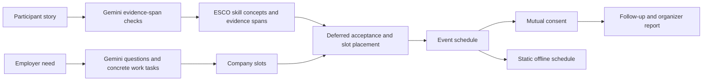
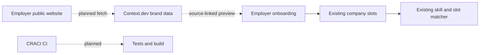

# Common Ground

Plan a recruitment open house around demonstrated skills, available slots and mutual consent.

[Open Common Ground](https://espoo-common-ground.vercel.app) · [Evaluation protocol](eval/v2/PROTOCOL.md) · [Release notes](docs/RELEASE.md)

Built by Shreyansh, team The CS Guy, for Junction 2026's City of Espoo Rethinking Recruitment challenge.

## What people do

A participant describes work they have actually done and approves the resulting skill evidence. An employer describes a hiring need, answers follow-up questions and turns it into concrete work tasks. An organizer prepares employer slots. Common Ground uses skill evidence to propose an event schedule, then lets both sides consent before a connection becomes a follow-up.

The workspace includes event planning, schedules, reports and follow-up. Static schedules remain readable offline with JavaScript disabled. The current October overview crash is fixed and the November workspace works. Data is synthetic, so trying the product does not contact real candidates or employers.

## Implemented architecture



Gemini asks follow-up questions, generates small work tasks and checks whether claimed skills have supporting spans. Deterministic matching and scheduling code uses those outputs. Identity and audit-group inputs do not enter the matcher. That design choice does not by itself establish fairness.

The current service uses Node.js and SQLite on cloud-hosted infrastructure, reached through the Vercel entry point. It does not rely on the builder's Mac. Live release `d858ba1` includes application changes that were not yet in the public branch when this README work began. This README-only publication does not publish the pending application commits.

## Sponsor and model roles

| Service | Current state and concrete role |
| --- | --- |
| Gemini API | Implemented. Follow-up questions, work tasks and evidence-span checks help participants describe skills. The model does not make a real hiring decision. |
| ESCO | Implemented. Shared skill concepts connect participant evidence and company needs. |
| Codex | Used to build, debug and verify the application. |
| CRACI | **Planned, not implemented.** Run the existing tests and build on CRACI CI. |
| Context.dev | **Planned, not implemented.** Fetch public company brand information and logos during employer onboarding. Matching remains based on skills and slots, without brand or identity inputs. |

The Context.dev plan must visibly support onboarding to meet the core-flow requirement. Fictional demo companies will not receive invented factual brand claims. Planned prize selections remain conditional on implementation and verification.

## Run locally

Use Node.js 24. Supply `GEMINI_API_KEY` securely in the process environment for new model requests. Existing cached evaluation outputs can be inspected without billing new requests.

```bash
npm ci
npm run dev
```

The project includes synthetic company and participant fixtures. Keep real personal data out of public fixtures, screenshots and evaluation outputs. The configured daily model-request counter is an application control, not a verified provider spending guarantee.

## Validate

```bash
npm test
npm run build
npm run eval
```

The evaluation uses cached outputs. The newer live release has a `scripts/fable-e2e.mjs` flow check, but that script is still in the unpublished application backlog. The published `npm run test:e2e` uses `scripts/e2e.mjs` and targets an older flow; it is not current live-release acceptance proof. Browser tests that write must use an isolated visitor copy and clean up. Do not run write checks or deploy while an active recording uses the shared product.

## What the evaluation says

The synthetic fixture contains 15 companies, 120 people and three story templates. The reported held-out good-match rate was 72.1%, compared with 41.7% for a keyword baseline and 86.6% for an AI-polished CV baseline. The recorded group access gap was 11.1 percentage points.

These are measured results from author-labelled synthetic cases and 20 repeated runs. They are not field hiring outcomes, legal compliance evidence or proof that this method is fairer than polished CVs. The polished-CV baseline performed better on the reported fit measure. Read the [protocol](eval/v2/PROTOCOL.md) before citing a number.

Before a real participant pilot, the project needs authenticated invitations, privacy and retention controls, transport hardening, and the appropriate assessment of employment-related AI use. Current consent screens do not complete that work.

## Planned architecture and completion checks



After implementation approval, the brand step needs a real public-company lookup, source attribution, logo fallback and a visible onboarding preview. A regression check must establish that brand data never changes skill scores. CRACI needs an actual successful GitHub Actions run on `runs-on: craci` with build and tests. Neither planned integration is active today.

## Repository guide

`server/server.mjs` serves the application; `server/ai.mjs` contains model integration. `src/` contains the browser workspace. `fixtures/` supplies synthetic data; `eval/v2/` defines the current evaluation. Documentation under `docs/` includes earlier handoffs, so compare its dates with the current behaviour described here.
